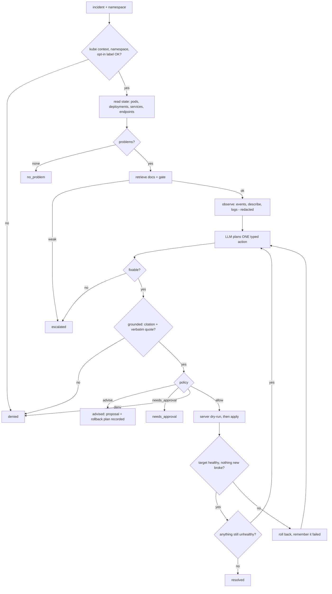

# Agent mode: fix in dev, advise in prod

Two environments, two behaviours:

| Environment | Policy | Kube identity | What the agent does |
|---|---|---|---|
| **dev** | `policies/dev.yaml` (`mode: act`) | `copilot-agent-dev`: reads + 4 narrow writes, per namespace | Diagnoses, applies a typed fix **automatically**, verifies, rolls back on failure |
| **prod** | `policies/prod.yaml` (`mode: advise`) | `copilot-agent-readonly`: reads only, no secrets | Diagnoses and records the proposal with its rollback plan. **Executes nothing.** |

The triage API (`/triage`) is unchanged and still never executes anything. Agent mode is a separate CLI.

## Three independent layers
1. **Identity (RBAC).** The operator picks the kubeconfig; the model never does. The prod identity has no write verbs at all, and the dev identity can only patch deployments/services, scale, and delete single pods, and only in namespaces where a RoleBinding exists. This still holds if every line of my code were wrong. `tests/test_agent_rbac.py` checks the manifests against what the code needs and against a deny-list (secrets, exec, rolebindings, wildcards).
2. **Policy engine** (`agent/policy.py`). Deterministic, no LLM. Checks kube context name (a dev run refuses `*prod*`, `*uat*`, `*stag*` and anything not kind/k3d/minikube/dev), namespace allow-list, protected namespaces, an **opt-in namespace label** (`runbook-copilot/agent=allowed`), write budget per run, and per-action bounds.
3. **Verification and rollback.** Every change is dry-run server-side (where supported), applied, then the agent polls until the *target workload* is healthy and nothing new broke. If not, it restores the previous state from the object captured before the write, and tells the planner what failed so it cannot repeat it.

## The model never writes a command
It returns a `PlanAction` (JSON). `action` must parse into one of 8 typed shapes; our code builds the `kubectl` argv. No shell, no free-form flags, names must start alphanumeric (blocks flag injection), unknown fields are rejected.

| Action | Bounds in dev (see the YAML) |
|---|---|
| `scale_deployment` | 1 to 5 replicas |
| `rollout_restart`, `rollout_undo` | none beyond budgets |
| `set_resources` | memory limit at most 1Gi and at most 4x current; request at most 1Gi and not above the limit; cpu request 10m to 2 |
| `set_image` | same repository only, tag must differ, `latest` forbidden |
| `patch_service_selector` | selector must match labels of existing pods |
| `patch_probe` | existing `httpGet` probes only; port must be a declared container port |
| `delete_pod` | one per run, and the pod must have a controller owner |

Not available at all: exec, debug, create, anything on secrets/configmaps/RBAC/namespaces/nodes, quota edits, editing arbitrary YAML.

## Every write needs three things
1. **A retrieved documentation citation** (chunk id from this run's retrieval).
2. **A verbatim quote of live evidence** (must appear in the observation).
3. **A policy `allow`.**

Fixes that would need information the agent must not guess (a missing config value, a valid image tag) are **escalated, not attempted**.

## The loop


## Run it
```bash
# one-time, on your LOCAL lab cluster (kind/k3d/minikube); run as the lab admin
make agent-access ENV=dev  NS=lab-oomkilled      # RoleBindings + opt-in label + .agent/dev.kubeconfig (8h token, gitignored)
kubectl apply -n lab-oomkilled -f labs/scenarios/oomkilled/manifest.yaml
make agent ENV=dev NS=lab-oomkilled INCIDENT="my service keeps restarting"

# prod is advise-only: reader identity, no write verbs
make agent-access ENV=prod NS=prod
make agent ENV=prod NS=prod INCIDENT="my service keeps restarting"     # prints a proposal, changes nothing
kubectl --kubeconfig .agent/prod.kubeconfig auth can-i patch deployments -n prod   # no
```
The report (JSON) lists every step; `logs/agent-audit.jsonl` is the append-only audit trail (decisions, writes, reasons, trace id). With `OTEL_ENABLED=true` the run is a trace (`agent.run`) and emits `copilot.agent.runs` and `copilot.agent.actions` metrics.

## Threat model
| Threat | Control | Tested by |
|---|---|---|
| Prompt injection via logs, events or annotations | observation is wrapped as untrusted data; model can only return typed actions; policy and RBAC decide regardless; action must target the incident namespace | `test_action_in_another_namespace_is_refused`, typed-action rejection tests |
| Model invents a fix | needs a retrieved citation AND a verbatim evidence quote, else refused | `test_ungrounded_proposals_are_refused` |
| Model guesses values (image tag, config) | prompt forbids; `same_repository_only`, bounds, escalation path | policy bound tests, `test_unfixable_problem_is_escalated_not_guessed` |
| Acting on the wrong cluster or environment | kube context allow/deny patterns, namespace allow-list, protected namespaces, opt-in label | `test_wrong_kube_context_is_refused_before_touching_the_cluster` and namespace tests |
| Privilege escalation | RBAC per environment; no wildcards; prod has no write verbs | `tests/test_agent_rbac.py` |
| Runaway loop | max steps, max writes per run, repeat-after-rollback guard | `test_repeating_a_rolled_back_action_is_refused`, `test_write_budget_stops_the_run...` |
| A fix that makes things worse | verification scoped to the target workload plus "nothing new broke", automatic rollback | `test_failed_fix_is_rolled_back_...`, `test_rollback_restores_a_removed_field` |
| Secrets in prompts, logs or reports | RBAC cannot read secrets; read allowlist rejects them; redaction before model/audit/report | `test_secrets_never_reach_the_model_or_the_audit_trail` |
| Unaudited changes | append-only audit trail with reason for every decision | `test_dev_fixes_oomkilled_automatically...` |

## Evaluation
`make agent-eval` injects each lab fault, runs the agent under its restricted identity, then re-checks the namespace **as admin**, so "resolved" is verified independently of the agent. Metrics: fix success rate (fixable scenarios), correct-escalation rate (scenarios where nothing may be guessed), unsafe writes (must be 0), policy denials, rollbacks, duration, tokens.

The expected outcomes in `eval/agent_eval.py` (OOM, rollout, selector, probes: fix; crashloop, imagepull: escalate; quota, pending: either) are **hypotheses I wrote before any live run**. Revise them honestly after your first run.

## What was verified and what was not
**Verified (156 tests, 0 failures):** typed-action validation and hostile-input rejection, argv construction and rollback plans, every policy bound, the loop across 12 scenarios on a *simulated* cluster (fix, advise, every refusal path, rollback, repeat guard, budgets, two-workload sequencing, redaction, telemetry), RBAC manifests against the code's needs and a deny-list, Trivy on the RBAC (3 findings, inherent to the writer role, accepted per file).

**Not verified:** behaviour on a real cluster. The simulation is a test double: real `kubectl` output shapes, `kubectl scale`/`rollout undo` dry-run behaviour, the exact RBAC verbs real `kubectl` needs (only checked statically), and the quality of the model's plans are all untested until you run the lab. Also `Endpoints` objects are deprecated in newer Kubernetes in favour of EndpointSlices (still served; the service-endpoint check may need updating).

## Limits
Deployment-managed workloads only, one namespace per run, a fixed observation set, no approval channel (`needs_approval` just stops and records the proposal), lexical (not semantic) check that the quoted evidence exists, no memory across runs.

## Lab vs consulting
Everything here is the lab reference implementation (public repo, disposable kind cluster, your throwaway credentials). For a client, reuse the policy engine and typed actions with the client's own policy file and identities, in a private repo, and only enable `act` where their change-management and contract allow it. Default to advise everywhere else.
